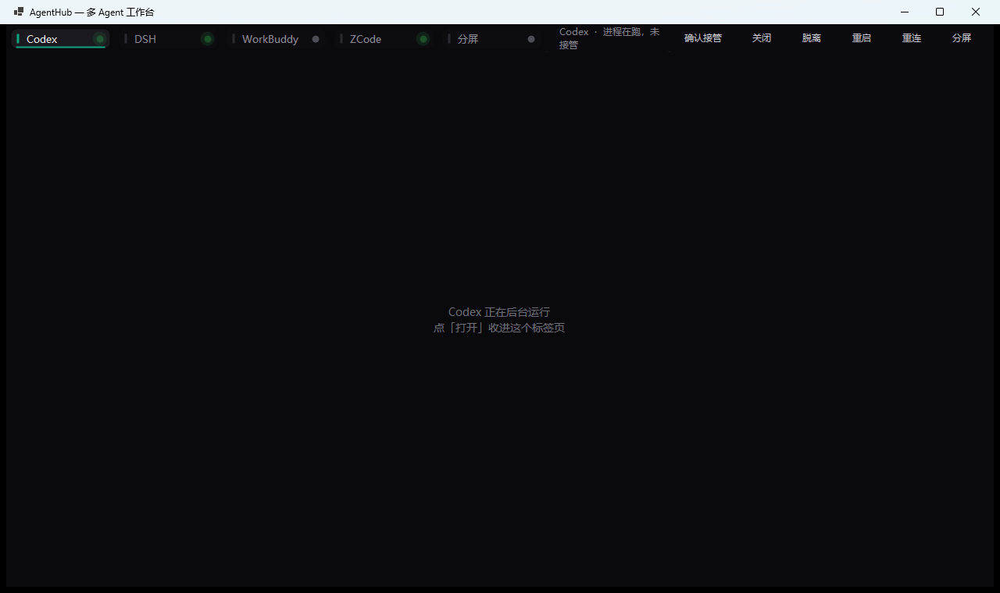

# AgentHub

一个 Windows 窗口，用标签页管理多个 AI Agent 桌面客户端：Codex、DeepSeek Harness、WorkBuddy、ZCode，以及任何你自己加的 Electron/Win32 程序。

不修改目标程序、不共享登录态、不注入代码 —— 只是用 Win32 `SetParent` 把它们的真实窗口挂进标签页。



## 特性

- **真窗口嵌入**：嵌入的是原生窗口，不是截图、不是 WebView 壳，键盘鼠标全部照常。
- **标签式切换**：`Ctrl+Alt+1~4` 全局热键，焦点在被嵌入的窗口里也能切。
- **状态灯**：常亮绿=已接管，呼吸绿=进程在跑但没接管，黄=启动中，红=失败，灰=没开。
- **打开 / 关闭**：直接拉起或结束对应 Agent 的进程。
- **多选分屏**：2 个左右分屏、3~4 个 2×2，同屏对照。
- **自动让出空间**：标签栏和工具按钮合并成一行，剩下的全是 Agent 的工作区。
- **可配置**：`agents.json` 里增删标签，不用改代码。

## 快速开始

### 环境

- Windows 10 / 11
- .NET 10 SDK

### 构建

```powershell
git clone https://github.com/a380467214-art/AgentHub.git
cd AgentHub
dotnet build -c Release
bin\Release\net10.0-windows\AgentHub.exe
```

### 首次使用

1. 打开 `bin\Release\net10.0-windows\agents.json`，把 `launch` 改成你自己机器上的路径。
2. 启动 `AgentHub.exe`。
3. 点标签 → 点「打开」。如果该程序已经在跑，第一次点只会提示，**再点一次才接管**（防止误抢正在用的窗口）。

## 配置

`agents.json` 是一个数组，每一项对应一个标签：

```json
[
  {
    "key": "zcode",
    "title": "ZCode",
    "launch": "%LOCALAPPDATA%\\Programs\\ZCode\\ZCode.exe",
    "processName": "ZCode",
    "accent": "#8B5CF6"
  }
]
```

| 字段 | 说明 |
|---|---|
| `key` | 唯一标识，命令行参数会用到 |
| `title` | 标签上显示的名字 |
| `launch` | 启动目标，支持 `%APPDATA%`、`%LOCALAPPDATA%`、`%ProgramFiles%` 环境变量；也可以是 `.lnk` |
| `processName` | 任务管理器里的进程名，用于查找窗口和判断是否在运行 |
| `accent` | 标签强调色，`#RRGGBB` |

> MSIX / 商店应用（例如 Codex）不能直接用 exe 路径启动，请在 `launch` 里写开始菜单快捷方式，例如
> `%APPDATA%\Microsoft\Windows\Start Menu\Programs\ChatGPT.lnk`。

## 使用

| 操作 | 说明 |
|---|---|
| 点标签 / `Ctrl+Alt+1~4` | 切换；`Ctrl+Alt` 是全局热键 |
| `Ctrl+Tab` | 下一个标签 |
| 打开 | 未运行则启动；已在运行第一次只提示，再点一次接管 |
| 关闭 | 结束该 Agent 的进程（二次确认） |
| 脱离 | 把窗口还回桌面，恢复原来的位置和标题栏 |
| 重连 | 解除挂载再挂一次，用于白屏/黑块时救场 |
| 重启 | 结束并重新拉起该 Agent |
| 分屏 | 选 2~4 个同屏显示；**只接管已在运行的，不会顺手拉起进程** |

命令行：

```powershell
AgentHub.exe --tab=zcode                      # 启动并接管 ZCode
AgentHub.exe --split=workbuddy,zcode          # 直接进 2 分屏
```

## 工作原理

```
MainForm
 ├─ TopBar（自绘标签 + 操作按钮）
 └─ Content Panel
     ├─ AgentHost[0].Container  ← SetParent(目标窗口)
     ├─ AgentHost[1].Container
     └─ ...
```

- 通过 `EnumWindows` 按进程名找到目标主窗口。
- 去掉 `WS_CAPTION` 等样式，加上 `WS_CHILD`，再 `SetParent` 到容器面板。
- 容器 `Resize` 和 250ms 定时器共同保证子窗口始终铺满。
- 跨进程键盘焦点用 `AttachThreadInput` + `SetFocus` 处理，接管完成后主动给一次焦点。

## 已知限制

- **同一时刻只有 4 个左右标签**：窗口最小宽度 1200 是给标签 + 按钮留的位置，再窄会挤。
- **弹窗会浮在整屏**：文件选择框、系统对话框不属于主窗口，会出现在屏幕中央而不是标签页里。
- **进程内存**：每个 Electron 客户端都是独立进程组，四五个全开大约 1.5–3 GB。
- **最大化状态还原**：接管时记录窗口位置，脱离时放回；但最大化状态会被还原成"同等大小"而不是最大化按钮状态。
- **任务栏**：嵌入后的窗口不再出现在任务栏，切回桌面请用热键或宿主窗口。

## 常见问题

**Q：接管后打字没反应？**
A：程序会在接管完成后自动聚一次焦，并把鼠标所在窗口的焦点每 250ms 校正一次。如果仍然没反应，点一下目标窗口的输入区，或按 `Ctrl+Alt+1~4` 重新切一次。

**Q：窗口黑屏 / 白屏？**
A：Electron 重新挂载后偶发首帧异常，程序会自动重绘两次；还不行就点「重连」。

**Q：能加别的软件吗？**
A：可以。只要是独立顶层窗口、有固定进程名，就能加进 `agents.json`。

## 许可

[MIT](LICENSE)
